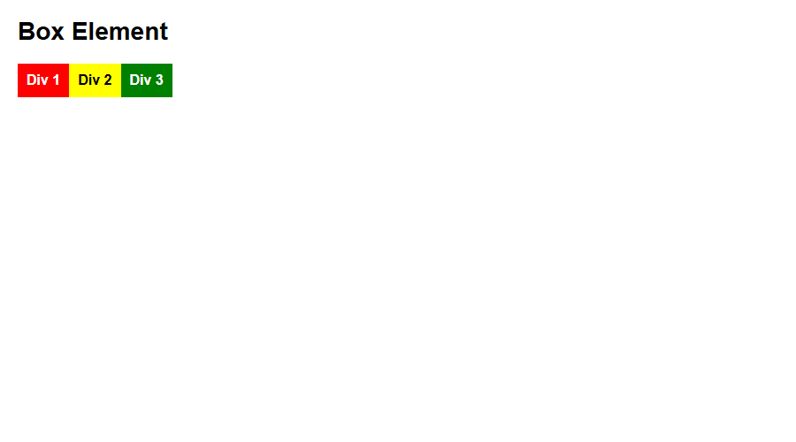

## Langkah-langkah Praktikum

### 1. Konsep Box Element dan CSS Float (`lab4_box.html`)
Elemen dalam dokumen HTML diperlakukan sebagai sebuah kotak (*box*) yang memiliki komponen Margin, Border, Padding, dan Content. Pada tahap awal, dibuat tiga elemen `div` tanpa pengaturan float:

```html
<section>
    <div class="div1">Div 1</div>
    <div class="div2">Div 2</div>
    <div class="div3">Div 3</div>
</section>
```

**Screenshot Hasil (Tanpa Float):**  


---

### 2. Menerapkan CSS Float Property
Menambahkan deklarasi `float: left` dan `padding: 10px` pada elemen `div` sehingga ketiga kotak mengambang dan tersusun horizontal ke samping:

```css
div {
    float: left;
    padding: 10px;
}
.div1 { background: red; }
.div2 { background: yellow; color: #000; }
.div3 { background: green; }
```

**Screenshot Hasil (Dengan Float):**  


---

### 3. Mengatur Clearfix Element
Ketika ditambahkan elemen keempat (`div4`), kita menerapkan properti `clear: left` agar elemen tersebut tidak ikut melayang di samping elemen sebelumnya, melainkan turun ke baris baru:

```css
.div4 {
    background-color: blue;
    clear: left;
    float: none;
}
```

**Screenshot Hasil (Clearfix):**  


---

### 4. Membangun Kerangka Semantic Layout (`lab4_layout/home.html`)
Menerapkan elemen HTML5 Semantic (`<header>`, `<nav>`, `<section id="hero">`, `<section id="wrapper">`, `<section id="main">`, `<aside id="sidebar">`, dan `<footer>`) di dalam pembungkus utama `<div id="container">`:

```html
<div id="container">
    <header><h1>Layout Sederhana</h1></header>
    <nav>
        <a href="home.html" class="active">Home</a>
        <a href="artikel.html">Artikel</a>
        <a href="about.html">About</a>
        <a href="kontak.html">Kontak</a>
    </nav>
    <section id="hero"></section>
    <section id="wrapper">
        <section id="main"></section>
        <aside id="sidebar"></aside>
    </section>
    <footer><p>&copy; 2021 - Universitas Pelita Bangsa</p></footer>
</div>
```

**Screenshot Hasil (Kerangka Semantik):**  


---

### 5. Penataan Header, Navigasi, dan Hero Panel
Mengonfigurasi file `style.css` dengan font Google (*Open Sans*), bilah navigasi berwarna biru `#1f5faa` dengan efek hover `#2b83ea`, serta area Hero Panel berlatar abu-abu `#e4e4e5`:

```css
#container {
    width: 980px;
    margin: 0 auto;
    box-shadow: 0 0 1em #cccccc;
}
nav {
    display: block;
    background-color: #1f5faa;
}
nav a {
    padding: 15px 30px;
    display: inline-block;
    color: #ffffff;
    font-size: 14px;
    text-decoration: none;
    font-weight: bold;
}
#hero {
    background-color: #e4e4e5;
    padding: 50px 20px;
    margin-bottom: 20px;
}
```

**Screenshot Hasil (Header & Hero):**  


---

### 6. Pembagian Dua Kolom (Main Content & Sidebar Widget)
Membagi area `#wrapper` menjadi dua kolom berdampingan menggunakan `float: left`:
- Kolom Utama (`#main`): selebar 640px.
- Kolom Samping (`#sidebar`): selebar 260px.
- Disertai pembuatan komponen widget (`.widget-box`) pada sidebar dan baris 3 kotak gambar lingkaran (`.box`, `.image-circle`) pada konten utama.

```css
#main {
    float: left;
    width: 640px;
    padding: 20px;
}
#sidebar {
    float: left;
    width: 260px;
    padding: 20px;
}
.box {
    display: block;
    float: left;
    width: 33.333333%;
    box-sizing: border-box;
    padding: 0 10px;
    text-align: center;
}
.image-circle {
    border-radius: 50%;
}
```

**Screenshot Hasil (Main Content & Sidebar):**  


---

### 7. Integrasi Artikel Featurette dan Footer
Menambahkan konten artikel `.entry` dengan perataan gambar dinamis (`float: left` dan `float: right`), serta menutup layout dengan elemen `footer` ber-clearfix (`clear: both; background-color: #1d1d1d;`):

```css
.entry img {
    float: left;
    border-radius: 5px;
    margin-right: 15px;
}
.entry .right-img {
    float: right;
    margin-right: 0;
    margin-left: 15px;
}
footer {
    clear: both;
    background-color: #1d1d1d;
    padding: 20px;
    color: #eee;
}
```

**Screenshot Hasil Utuh Halaman Beranda (`home.html`):**  


---
