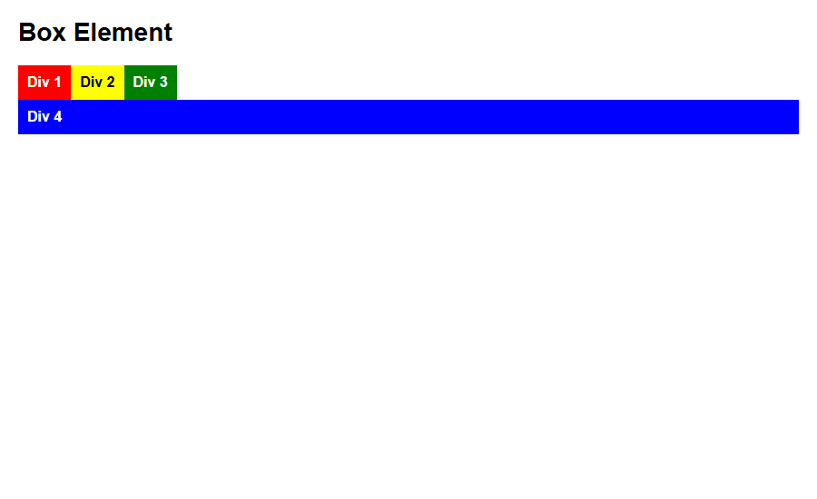
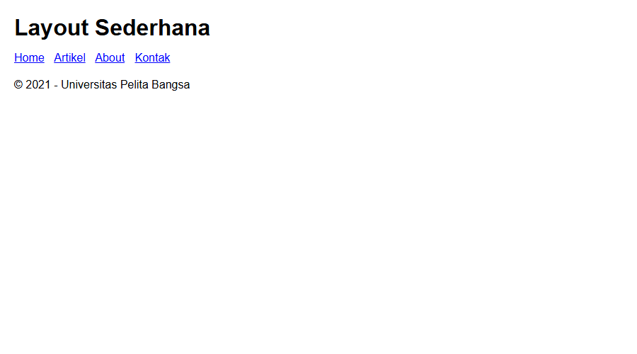
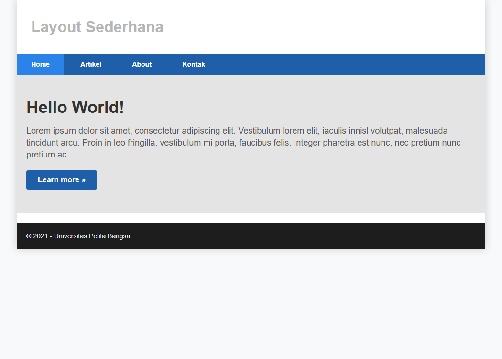
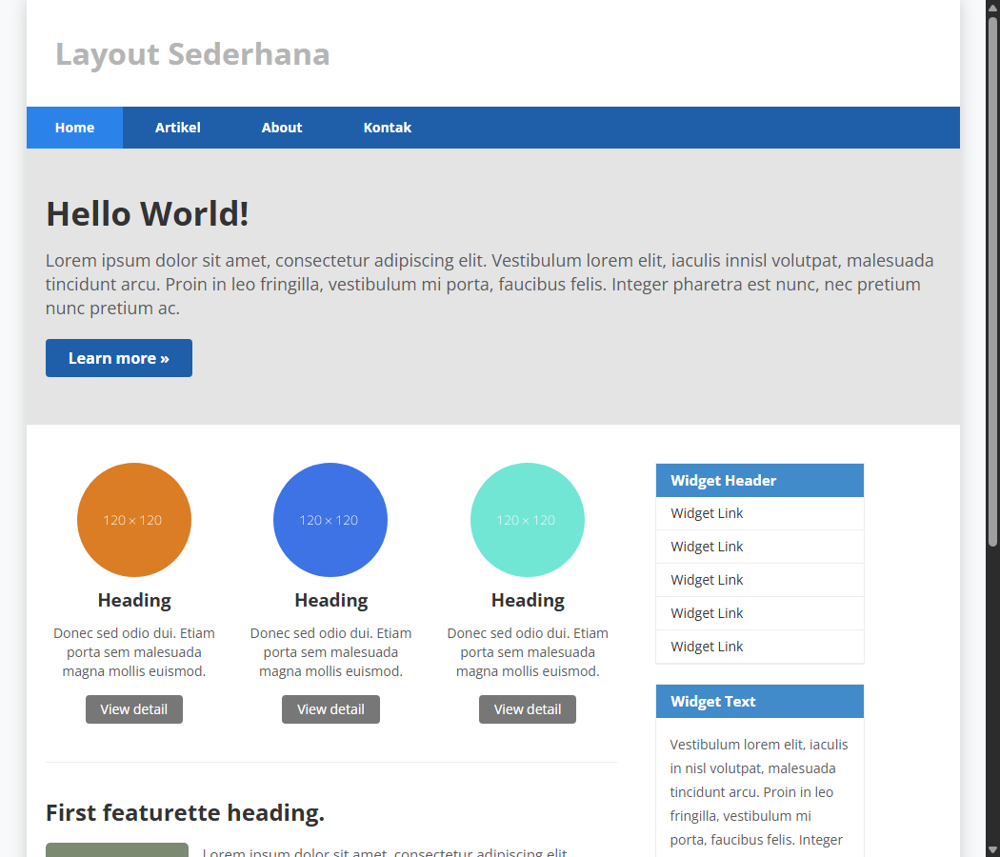
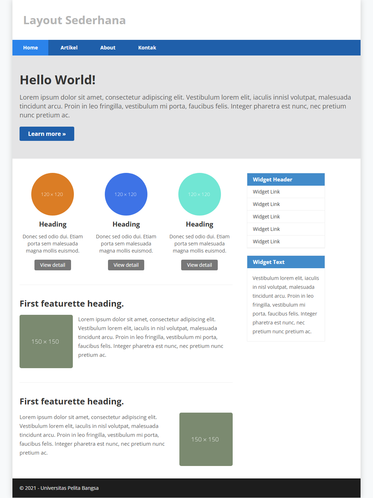
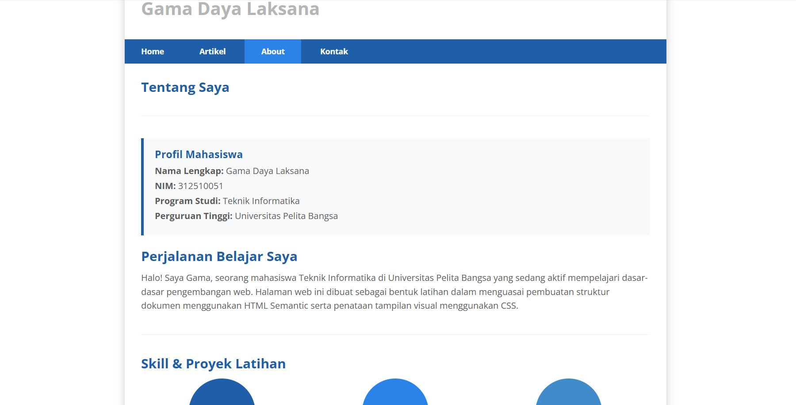
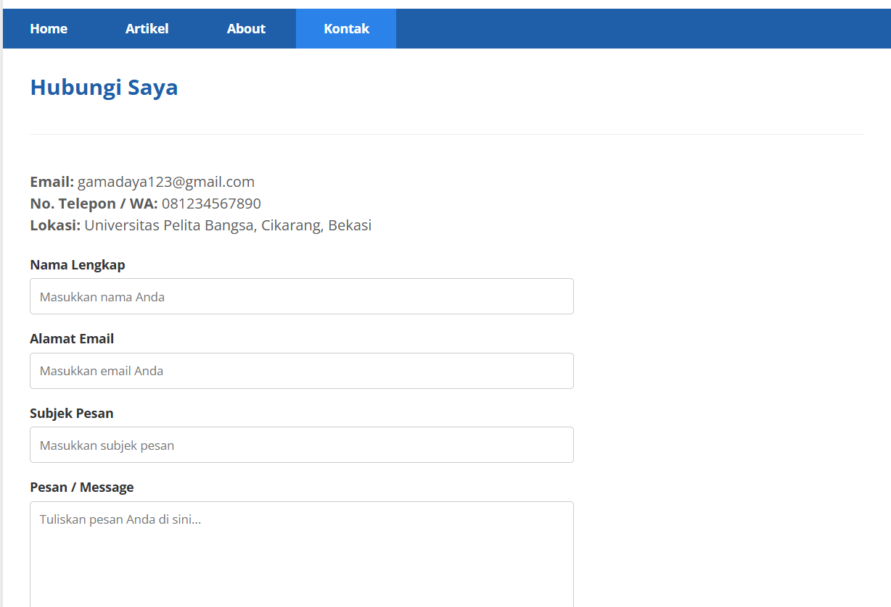

# Praktikum 4: CSS Layout

Repository ini disusun untuk memenuhi tugas **Praktikum 4 - CSS Layout** pada mata kuliah Pemrograman Web.

**Identitas Mahasiswa:**
- **Nama:** Gama Daya Laksana
- **NIM:** 312510051
- **Kelas:** I253A
- **Program Studi:** Teknik Informatika
- **Dosen Pengampu:** Agung Nugroho, S.Kom., M.Kom.
- **Kampus:** Universitas Pelita Bangsa

---


# Langkah-Langkah Praktikum

## 1. Konsep Box Element dan CSS Float (`lab4_box.html`)

### Kode HTML

```html
<section>
    <div class="div1">Div 1</div>
    <div class="div2">Div 2</div>
    <div class="div3">Div 3</div>
</section>
```

### Kode CSS

```css
div {
    float: left;
    padding: 10px;
}

.div1 { background: red; }
.div2 { background: yellow; color: #000; }
.div3 { background: green; }
```

**Screenshot Hasil:**


### Penjelasan

**Struktur HTML (`<section>` dan `<div>`)**

Sebuah elemen induk `<section>` berisi tiga elemen anak berbentuk kotak (`<div>`) dengan kelas `div1`, `div2`, dan `div3`.

**Aturan Umum untuk Semua `div` (`div { ... }`)**

- `float: left;`: Membuat ketiga kotak yang tadinya tersusun secara vertikal menjadi berjajar ke samping kiri secara horizontal.
- `padding: 10px;`: Menambahkan ruang di dalam setiap kotak antara teks dan bagian tepinya.

**Styling Spesifik per Kotak (`.div1`, `.div2`, `.div3`)**

- `.div1`: Memberikan warna latar belakang merah.
- `.div2`: Memberikan warna latar belakang kuning dengan teks berwarna hitam (`#000`).
- `.div3`: Memberikan warna latar belakang hijau.

## 2. Mengatur Clearfix Element

### Kode CSS

```css
.div4 {
    background-color: blue;
    clear: left;
    float: none;
}
```

**Screenshot Hasil (Clearfix):**



### Penjelasan Properti

**`background-color: blue;`**

- **Fungsi:** Memberikan warna latar belakang biru pada elemen dengan kelas `.div4`.
- **Kegunaan:** Membantu melihat batas atau area elemen `div` di dalam halaman web.

**`clear: left;`**

- **Fungsi:** Menentukan sisi elemen yang tidak boleh berdekatan dengan elemen yang melayang (*floating*).
- **Kegunaan:** Dengan nilai `left`, elemen `.div4` dipaksa turun ke bawah jika di sebelah kirinya terdapat elemen lain yang menggunakan `float: left;`. Properti ini memastikan `.div4` tidak sejajar di samping elemen *floating* sebelah kiri, melainkan berada di bawahnya.

**`float: none;`**

- **Fungsi:** Menonaktifkan sifat melayang (*float*) pada elemen tersebut.
- **Kegunaan:** Memastikan elemen `.div4` kembali ke perilaku tata letak normal sebagai elemen blok dan tidak lagi mengambang.

### Kesimpulan Konsep Clearfix

Properti `clear` digunakan untuk mengatur posisi elemen agar tidak berada di samping elemen yang menggunakan `float`. Properti ini membantu merapikan tata letak agar elemen di bawahnya tidak bertumpuk dengan elemen *floating*. Secara teknis, `clear` berbeda dengan teknik *clearfix*, yang digunakan untuk membuat elemen induk menampung elemen-elemen *floating* di dalamnya.

## 3. Membangun Kerangka Semantic Layout (`lab4_layout/home.html`)

### Kode HTML

```html
<div id="container">
    <header><h1>Layout Sederhana</h1></header>
    <nav>
        <a href="home.html" class="active">Home</a>
        <a href="artikel.html">Artikel</a>
        <a href="about.html">About</a>
        <a href="kontak.html">Kontak</a>
    </nav>
    <section id="hero"></section>
    <section id="wrapper">
        <section id="main"></section>
        <aside id="sidebar"></aside>
    </section>
    <footer><p>&copy; 2021 - Universitas Pelita Bangsa</p></footer>
</div>
```

**Screenshot Hasil (Kerangka Semantik):**



### Penjelasan Elemen

- **`<div id="container">`:** Pembungkus utama (*wrapper*) untuk menampung seluruh elemen halaman web agar mudah diatur posisinya di tengah layar.
- **`<header>`:** Bagian kepala halaman yang biasanya berisi judul utama web atau logo. Pada contoh ini, bagian tersebut berisi judul "Layout Sederhana".
- **`<nav>`:** Bagian navigasi atau menu tautan untuk berpindah halaman, yaitu Home, Artikel, About, dan Kontak. Kelas `active` pada menu Home menandakan halaman yang sedang aktif.
- **`<section id="hero">`:** Area banner atau *hero image* di bawah navigasi, biasanya digunakan untuk menyoroti konten utama atau gambar menarik.
- **`<section id="wrapper">`:** Pembungkus tambahan untuk mengatur tata letak dua kolom di bawah hero.
- **`<section id="main">`:** Area untuk konten utama artikel atau informasi penting.
- **`<aside id="sidebar">`:** Area *sidebar* yang biasanya berisi widget, menu tambahan, atau informasi pendukung.
- **`<footer>`:** Bagian kaki halaman yang berisi informasi hak cipta (*copyright*) atau identitas pembuat, seperti Universitas Pelita Bangsa.

## 4. Penataan Header, Navigasi, dan Hero Panel

### Kode CSS

```css
#container {
    width: 980px;
    margin: 0 auto;
    box-shadow: 0 0 1em #cccccc;
}

nav {
    display: block;
    background-color: #1f5faa;
}

nav a {
    padding: 15px 30px;
    display: inline-block;
    color: #ffffff;
    font-size: 14px;
    text-decoration: none;
    font-weight: bold;
}

#hero {
    background-color: #e4e4e5;
    padding: 50px 20px;
    margin-bottom: 20px;
}
```

**Screenshot Hasil (Header & Hero):**



### Penjelasan CSS

**`#container`**

- `width: 980px;`: Mengatur lebar total kontainer halaman web menjadi 980 piksel.
- `margin: 0 auto;`: Membuat kontainer berada di tengah layar secara horizontal.
- `box-shadow: 0 0 1em #cccccc;`: Memberikan efek bayangan tipis berwarna abu-abu di sekeliling kontainer agar tampak menonjol.

**`nav`**

- `display: block;`: Memastikan elemen navigasi ditampilkan sebagai elemen blok.
- `background-color: #1f5faa;`: Memberikan warna latar belakang biru tua pada area menu navigasi.

**`nav a`**

Mengatur gaya untuk setiap tautan di dalam menu.

- `padding: 15px 30px;`: Memberikan ruang di dalam tautan agar lebih nyaman diklik.
- `display: inline-block;`: Memungkinkan tautan memiliki ukuran dan *padding* tetapi tetap berjejer ke samping.
- `color: #ffffff;`: Mengubah warna teks menjadi putih.
- `font-size: 14px;`: Mengatur ukuran teks menjadi 14 piksel.
- `text-decoration: none;`: Menghilangkan garis bawah bawaan tautan.
- `font-weight: bold;`: Membuat teks menjadi tebal.

**`#hero`**

- `background-color: #e4e4e5;`: Memberikan warna latar belakang abu-abu terang pada area hero panel.
- `padding: 50px 20px;`: Memberikan jarak di dalam area hero agar terlihat luas dan lega.
- `margin-bottom: 20px;`: Memberikan jarak kosong di bawah hero panel sebelum bagian konten berikutnya.

## 5. Pembagian Dua Kolom (Main Content & Sidebar Widget)

Area `#wrapper` dibagi menjadi dua kolom berdampingan menggunakan `float: left`:

- Kolom utama (`#main`) selebar 640 piksel.
- Kolom samping (`#sidebar`) selebar 260 piksel.
- Komponen widget (`.widget-box`) dibuat pada sidebar.
- Tiga kotak gambar berbentuk lingkaran (`.box`, `.image-circle`) ditampilkan pada konten utama.

### Kode CSS

```css
#main {
    float: left;
    width: 640px;
    padding: 20px;
}

#sidebar {
    float: left;
    width: 260px;
    padding: 20px;
}

.box {
    display: block;
    float: left;
    width: 33.333333%;
    box-sizing: border-box;
    padding: 0 10px;
    text-align: center;
}

.image-circle {
    border-radius: 50%;
}
```

**Screenshot Hasil (Main Content & Sidebar):**



### Penjelasan CSS

**`#main` (Konten Utama)**

- `float: left;`: Membuat elemen konten utama mengambang ke sebelah kiri.
- `width: 640px;`: Menetapkan lebar area konten utama.
- `padding: 20px;`: Memberikan jarak di bagian dalam agar teks atau elemen tidak menempel langsung pada tepi.

**`#sidebar` (Sidebar Widget)**

- `float: left;`: Membuat sidebar ikut mengambang ke kiri sehingga berdampingan secara horizontal dengan `#main`.
- `width: 260px;`: Menetapkan lebar area sidebar.
- `padding: 20px;`: Memberikan jarak di dalam agar isi sidebar terlihat rapi.

  **Catatan:** Jika model kotak CSS yang digunakan adalah `content-box` (nilai bawaan), lebar aktual `#main` menjadi 680 piksel dan `#sidebar` menjadi 300 piksel karena *padding* ditambahkan di luar `width`. Dengan demikian, totalnya 980 piksel, belum termasuk kemungkinan batas atau *margin*. Jika ingin lebar yang ditetapkan sudah mencakup *padding*, gunakan `box-sizing: border-box;`.

**`.box` (Kotak Grid / Kolom Tambahan)**

- `width: 33.333333%;`: Membagi area menjadi tiga bagian sama lebar dalam satu baris.
- `float: left;` dan `display: block;`: Membuat kotak-kotak berjejer ke samping.
- `box-sizing: border-box;`: Memastikan ukuran lebar 33,3% sudah mencakup *padding*, sehingga tidak merusak tata letak.
- `padding: 0 10px;`: Memberikan jarak horizontal di antara kotak.
- `text-align: center;`: Membuat teks atau gambar di dalam kotak berada di tengah.

**`.image-circle`**

- `border-radius: 50%;`: Membuat gambar atau elemen berbentuk kotak menjadi lingkaran jika lebar dan tingginya sama. Jika dimensinya berbeda, bentuknya akan menjadi elips.

## 6. Integrasi Artikel Featurette dan Footer

### Kode CSS

```css
.entry img {
    float: left;
    border-radius: 5px;
    margin-right: 15px;
}

.entry .right-img {
    float: right;
    margin-right: 0;
    margin-left: 15px;
}

footer {
    clear: both;
    background-color: #1d1d1d;
    padding: 20px;
    color: #eee;
}
```

**Screenshot Hasil Utuh Halaman Beranda (`home.html`):**



### Penjelasan CSS

**`.entry img` (Gambar Artikel Standar)**

- `float: left;`: Membuat gambar berada di sebelah kiri teks, sehingga teks dapat mengalir di sebelah kanan gambar.
- `border-radius: 5px;`: Membuat sudut gambar sedikit melengkung.
- `margin-right: 15px;`: Memberikan jarak kosong di sebelah kanan gambar agar tidak menempel pada teks.

**`.entry .right-img` (Gambar Artikel Posisi Kanan)**

- `float: right;`: Mengubah posisi gambar agar berada di sebelah kanan teks.
- `margin-right: 0;`: Menghapus jarak di sisi kanan.
- `margin-left: 15px;`: Memberikan jarak di sebelah kiri gambar agar teks tidak menempel.

**`footer` (Bagian Kaki Halaman)**

- `clear: both;`: Memastikan footer berada di bawah elemen-elemen yang menggunakan properti `float` sebelumnya, seperti `#main` dan `#sidebar`, sehingga footer tidak naik dan menimpa konten di atasnya.
- `background-color: #1d1d1d;`: Memberikan warna latar belakang hitam atau abu-abu gelap.
- `padding: 20px;`: Memberikan jarak di dalam area footer agar terlihat lega.
- `color: #eee;`: Mengubah warna teks menjadi abu-abu terang agar mudah dibaca di atas latar belakang gelap.


Pertanyaan	dan	Tugas
1. Tambahkan Layout untuk menu About
=> buat single layout yang berisi deskripsi, portfolio, dll



2. Tambahkan layout untuk menu Contact
=> yang berisi form isian: nama, email, message, dll




## Checklist Sebelum Dikumpulkan

- [x] Latihan Box Element dan Float berhasil dibuat (`lab4_box.html`).
- [x] Eksperimen clearfix (`clear: left`) berhasil memisahkan baris elemen float.
- [x] Kerangka Semantic HTML5 (`header`, `nav`, `section`, `article`, `aside`, `footer`) diimplementasikan secara terstruktur.
- [x] Layout web sederhana dua kolom (Main Content 640px dan Sidebar 260px) berfungsi dengan proporsional.
- [x] Tiga kotak kolom gambar lingkaran (`.image-circle`) dan featurette artikel bergambar (`float: left` & `float: right`) berhasil ditampilkan.
- [x] Tugas 1 (Single layout menu About `about.html`) telah selesai dibuat dengan profil dan portofolio.
- [x] Tugas 2 (Layout menu Contact `kontak.html`) telah selesai dibuat dengan formulir dan widget kontak.
- [x] Folder `screenshots/` memuat 9 tangkapan layar lengkap (`1.png` - `9.png`).
- [x] Folder `Laporan/` diabaikan oleh Git melalui `.gitignore`.
- [x] Berkas `README.md` disusun rapi dan mendalam sesuai modul.
- [x] Perubahan di-commit secara lokal di repositori dan siap di-push manual oleh mahasiswa.
